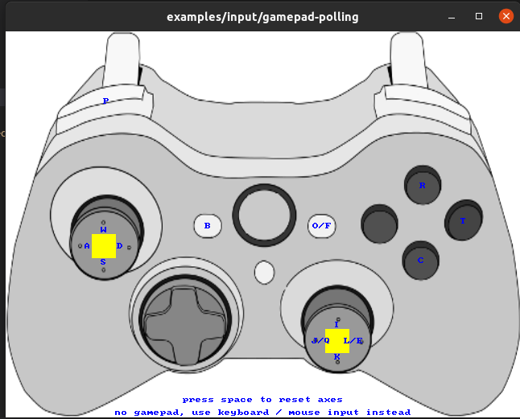

# LejuLab-Deploy

[](https://opensource.org/licenses/MIT) [](http://wiki.ros.org/noetic) [](https://ubuntu.com/) [](https://isocpp.org/) []()

本文说明 Roban 2.2（`ROBOT_VERSION=17`）的 MuJoCo 仿真。

## 功能特性

- **机器人支持**：支持 Roban 2.2（`ROBOT_VERSION=17`）人形机器人
- **Mujoco 仿真**：基于 Mujoco 物理引擎的高精度仿真环境
- **强化学习控制器**：内置 AMP 行走、Mimic 舞蹈等控制算法
- **手柄遥控**：支持游戏手柄进行机器人遥控操作
- **高性能通信**：基于 CycloneDDS + iceoryx 共享内存的低延迟进程间通信

## 系统架构

```
+-----------------------------------------------------------------------------------+
|                              Control Layer                                        |
+-----------------------------------------------------------------------------------+
|                                                                                   |
|                        +-----------------------------+                            |
|                        |     ControllerManager       |                            |
|                        |                             |                            |
|                        |  ControllerBase (Plugin)    |                            |
|                        |   +---------------------+   |                            |
|                        |   | GenericRLController |   |                            |
|                        |   | - ONNX/OpenVINO     |   |                            |
|                        |   | - Observation Terms |   |                            |
|                        |   | - Action Scaling    |   |                            |
|                        |   +---------------------+   |                            |
|                        |   + ArmController           |                            |
|                        |   + WaistController         |                            |
|                        +-----------------------------+                            |
|                                                                                   |
+-----------------------------------------------------------------------------------+
                                       |
                        +--------------+--------------+
                        |                             |
                        v                             |
             publishRobotCmd(cmd)          subscribeXxx(callback)
                  [Send Cmd]                   [Recv Data]
                        |                             |
                        v                             |
+-----------------------------------------------------------------------------------+
|                                  lejusdk                                          |
+-----------------------------------------------------------------------------------+
|                                                                                   |
|    +-----------------------------------------------------------------------+      |
|    |                      liblejusdk-lowlevel.so                           |      |
|    |                                                                       |      |
|    |    +-----------------+       +----------------------------------+     |      |
|    |    |  GlobalRobot    |       |          RobotBaseAPI            |     |      |
|    |    |  (Singleton)    |------>|                                  |     |      |
|    |    +-----------------+       |  subscribeImuData(callback)      |     |      |
|    |                              |  subscribeRobotState(callback)   |     |      |
|    |                              |  subscribeJoyData(callback)      |     |      |
|    |                              |  subscribeHardwareState(callback)|     |      |
|    |                              |  publishRobotCmd(cmd)            |     |      |
|    |                              |                                  |     |      |
|    |                              |       +--------------+           |     |      |
|    |                              |       |RobanHumanoid |           |     |      |
|    |                              |       +--------------+           |     |      |
|    |                              +----------------------------------+     |      |
|    +-----------------------------------------------------------------------+      |
|                                                                                   |
|    +-----------------------------------------------------------------------+      |
|    |                      liblejusdk-vr.so                                |      |
|    |                                                                       |      |
|    |    VR Head/Arm/Waist control API, used by leju-ik                |      |
|    +-----------------------------------------------------------------------+      |
|                                                                                   |
+-----------------------------------------------------------------------------------+
                        |                             ^
                        |                             |
                        v                             |
              +-----------------+           +-----------------+
              |    RobotCmd     |           |    ImuData      |
              |  - q[]  (pos)   |           |    RobotState   |
              |  - v[]  (vel)   |           |    JoyData      |
              |  - tau[] (torq) |           |    HardwareState|
              |  - kp[] (stiff) |           +-----------------+
              |  - kd[] (damp)  |                   ^
              |  - modes[]      |                   |
              +-----------------+                   |
                        |                           |
                        v                           |
+-----------------------------------------------------------------------------------+
|                              Hardware / Sim                                       |
+-----------------------------------------------------------------------------------+
|                                                                                   |
|    +---------------------------+       +---------------------------+              |
|    |     leju-mujoco-sim       |       |      leju-hardware        |              |
|    |                           |       |                           |              |
|    |   +-------------------+   |       |   +-------------------+   |              |
|    |   | MuJoCo Physics    |   |       |   | EtherCAT Driver   |   |              |
|    |   | Sensor Simulation |   |       |   | IMU Data Collect  |   |              |
|    |   | Motor Execution   |   |       |   | Joint Feedback    |   |              |
|    |   +-------------------+   |       |   +-------------------+   |              |
|    |                           |       |                           |              |
|    |       [Simulation]        |       |      [Real Robot]         |              |
|    +---------------------------+       +---------------------------+              |
|                                                                                   |
+-----------------------------------------------------------------------------------+
```

## 目录结构

```bash
tree src -d -L 2
src
├── leju_assets       # 资源模块，自动同步，不要编辑
│   ├── include
│   ├── models
│   └── src
├── leju-controllers  # 控制器
│   ├── leju-dummy-controller
│   └── leju-rl-controller
├── leju-ik           # Quest3 IK 解算模块
│   ├── config
│   ├── include
│   ├── src
│   └── test
├── leju_launch       # 提供一键启动所有必要的功能模块
│   ├── config
│   ├── launch
│   └── scripts
├── leju-remote       # Quest3 数据接入与 UDP 转发工具
│   ├── protos
│   ├── protos_c
│   └── src
├── leju-vr-control   # Quest3 VR 控制节点（手臂、头部、速度、腰部控制）
│   ├── config
│   ├── include
│   └── src
└── lejusdk           # Leju SDK，自动同步，不要编辑
    ├── examples
    ├── lejusdk-lowlevel   # 底层控制 SDK，提供电机控制与状态读取、IMU 传感器状态读取接口等
    ├── lejusdk-utils      # SDK 工具类, 提供辅助函数
    └── lejusdk-vr         # 外部控制 SDK，提供头部、手臂和腰部控制以及控制器相关接口
```

## 仿真（推荐使用 Docker）

在 Docker 里编译并运行 MuJoCo，镜像里已经带有 ROS Noetic，本机只安装 Docker，不必再安装 ROS。下面的命令除进入容器外，都在容器里、仓库根目录执行。容器默认 shell 是 zsh。

### 1. 前提条件

安装 Docker。使用 GPU 时，再安装与显卡驱动匹配的 [NVIDIA Container Toolkit](https://docs.nvidia.com/datacenter/cloud-native/container-toolkit/latest/index.html)。

### 2. 进入容器

在仓库根目录执行，普通模式和 GPU 模式二选一：

```bash
./docker/run.sh
# 或
./docker/run_with_gpu.sh
```

本机还没有 `kuavo_opensource_mpc_wbc_img` 时，自行下载后导入，再执行上面的脚本：

```bash
wget https://kuavo.lejurobot.com/kuavo_research_editiion/docker_images/kuavo_opensource_mpc_wbc_img_v1.3.0.tar.gz
docker load -i kuavo_opensource_mpc_wbc_img_v1.3.0.tar.gz
```

### 3. 依赖安装

```bash
sudo apt-get update && sudo apt-get install -y \
    build-essential cmake \
    libacl1-dev libncurses5-dev
```

### 4. 编译

`installed/setup.zsh` 在镜像里，不在 git 仓库中。它负责把 CycloneDDS、iceoryx 等依赖放进当前终端。`catkin build` 的结果在 `devel/`，之后每次开终端运行节点时加载 `devel/setup.zsh`。

```bash
source installed/setup.zsh
catkin build
```

### 5. 配置 iceoryx 共享内存

首次使用时执行。用共享内存降低进程间延迟。

```bash
./src/leju_launch/scripts/setup_cyclonedds_config_for_docker.sh
```

### 6. 运行

仓库默认控制器是 `amp`。要在仿真里换成自己的模型，先看后面的「在仿真里使用自己的策略」，再执行：

```bash
source devel/setup.zsh
export ROBOT_VERSION=17
roslaunch leju_launch load_mujoco_sim.launch
```

- 上述命令会同时启动控制器、MuJoCo 仿真器和手柄
- 按终端提示按下手柄 `start`
- 在 MuJoCo 窗口点击 `Run`
- 机器人一开始倒地时，先 `Pause`、`Reset`，再 `Run`

## 通用说明

- `start`：进入站立
- `back` + `start`：退出程序。运行中先下蹲再退出；尚未进入运行时直接退出
- 其余按键见 `src/leju-controllers/leju-rl-controller/config/17/teleop_bindings.yaml` 和 [手柄绑定](src/leju-controllers/leju-rl-controller/docs/teleop_bindings.md)

## 在仿真里使用自己的策略

下面用仓库里的「恶作剧」说明仿真里一条舞蹈从文件到按键的接法。自己加一条时，复制 CSV、ONNX 和控制器 YAML，再在 `controller_manager.yaml` 与 `teleop_bindings.yaml` 各加一条。

这里有两个名字：

- 动作名写在控制器 YAML 里。恶作剧是 `恶作剧`，对应 `default_motion` 和 `motions.name`。
- 控制器名写在注册和按键里。恶作剧是 `mimic_dance_ezuoju`。`controller_manager.yaml` 的 `name` 和按键 `args.name` 用这同一个字符串。

根目录是 `src/leju-controllers/leju-rl-controller/config/17/`。

| 环节 | 恶作剧所用文件 | 里面要对上的名字 |
| --- | --- | --- |
| CSV | `motion_data/lxh_ezuoju_50fps_deploy.csv` | 动作名 `恶作剧` |
| ONNX | `policy/dance/lxh_robans17_ezuoju_073117_79999.onnx` | 由控制器 YAML 的 `policy_path` 指向 |
| 控制器 | `controllers/config_mimic_dance_ezuoju.yaml` | 动作名 `恶作剧` |
| 注册 | `controller_manager.yaml` 中的 `mimic_dance_ezuoju` | 与按键绑定相同 |
| 按键 | `teleop_bindings.yaml` 的 `LT+RT+A` | `mimic_dance_ezuoju` |

`default_controller` 保持 `amp`。仿真启动后先站立、行走；恶作剧靠按键切过去，播完再自动回到 `amp`。

### 1. CSV 和 ONNX

CSV 是仿真用的轨迹，ONNX 是训练导出的策略。恶作剧这两份已经放在：

```text
config/17/motion_data/lxh_ezuoju_50fps_deploy.csv
config/17/policy/dance/lxh_robans17_ezuoju_073117_79999.onnx
```

新动作按同样位置放置：轨迹进 `motion_data/`，策略进 `policy/dance/`。

### 2. 控制器 YAML

`controllers/config_mimic_dance_ezuoju.yaml` 把上面两个文件接到控制器上。路径相对于这份 YAML 所在的 `controllers/` 目录，所以要写 `../policy` 和 `../motion_data`。

```yaml
HumanoidRobotCfg:
  inference_engine: onnxruntime
  loop_dt: 0.001
  policy_path: ../policy/dance/lxh_robans17_ezuoju_073117_79999.onnx
  motion:
    default_motion: 恶作剧
    motions:
      - name: 恶作剧
        file: ../motion_data/lxh_ezuoju_50fps_deploy.csv
    auto_switch_back:
      enabled: true
      target_controller: amp
```

`default_motion` 必须等于 `motions` 里某一项的 `name`。按键只负责切到这个控制器并自动播放默认动作，动作名用的是这里的 `恶作剧`，控制器注册名用的是下一节的 `mimic_dance_ezuoju`，两者不是同一个字符串。

同文件后半段的 `env.robot` 要和训练导出的 `env.yaml` 对齐：`joint_default_pos` 对 `joint_pos`，`actuator_kp` 对 `stiffness`，`actuator_kd` 对 `damping`，`action_scale` 对 `actions`。`auto_switch_back` 打开后，这段舞蹈播完会切回 `amp`。

### 3. 注册到 controller_manager.yaml

在 `controllers:` 列表里增加一条。`name` 是按键和 `switch` 命令使用的控制器名，`config` 相对于 `config/17/controller_manager.yaml`。

```yaml
  - name: "mimic_dance_ezuoju"
    type: "GenericRLController"
    config: "controllers/config_mimic_dance_ezuoju.yaml"
    music: "dance_ezuoju.wav"
    music_delay: 1.0
    enabled: true
```

`music` 和 `music_delay` 可选。恶作剧在动作开始约 1 秒后播放 `dance_ezuoju.wav`。`enabled: true` 才会被加载。文件顶部的 `default_controller: "amp"` 不用改成舞蹈名。

### 4. 绑定按键

`teleop_bindings.yaml` 里，松开 `LT+RT+A` 切到 `mimic_dance_ezuoju`，并自动播放该控制器的默认动作：

```yaml
  - buttons: ["LT", "RT", "A"]     # 恶作剧（舞蹈）
    edge: release
    action:
      type: SwitchController
      args:
        name: mimic_dance_ezuoju
        auto_start_motion: true
```

`args.name` 必须和 `controller_manager.yaml` 的 `name` 一致。`edge: release` 表示松开组合键才触发。`auto_start_motion: true` 表示切换完成后播放 `default_motion`（恶作剧）。

使用顺序：`start` 站立并进入 `amp`，再同时按住 `LT`、`RT` 和 `A`，松开后开始恶作剧。播完回到 `amp`。左摇杆前后左右、右摇杆转向仍然是 `amp` 的行走。退出程序用 `back` + `start`。

新舞蹈沿用这个结构：选一组未占用的按键，`args.name` 写成你在 `controller_manager.yaml` 里注册的新名字，并带上 `auto_start_motion: true`。改完重新启动仿真。


## 输入控制设备

### 手柄



## Controller CLI 工具

`controller_cli` 是一个命令行交互工具，可通过 DDS 接口在运行时查询状态、切换控制器、设置控制模式等，无需手柄。

仿真已经启动后再开一个终端，进入正在运行的容器。这个工具不需要 root。

```bash
docker ps
docker exec -it <container_id> zsh
source devel/setup.zsh
export ROBOT_VERSION=17
controller_cli
```

`help` 打印的命令如下。程序里没有 `runtime`、`motion`、`start`、`stop`、`walkcontrol`。

| 命令 | 说明 |
| --- | --- |
| `list` | 查看当前控制器和可用控制器 |
| `switch <name>` | 切换控制器，例如 `switch amp` |
| `mode <arm\|waist> <keep\|auto\|external>` | 设置手臂或腰的控制模式 |
| `refresh` | 刷新并显示状态 |
| `clear` | 清屏 |
| `help` | 帮助 |
| `quit` / `exit` | 退出 |

站立用手柄 `start`，退出程序用 `back` + `start`。切换舞蹈控制器用 `switch`，名字与 `controller_manager.yaml` 里的 `name` 一致。

## 日志与录制数据

运行时产生的日志和录制数据统一存放在 `~/.ros/lejulab/` 目录下：

```
~/.ros/lejulab/
├── stdout/                          # stdout 日志
│   ├── 2026-04-01_18-29-20/
│   │   └── stdout.log
│   └── ...
├── mcap/                            # MCAP 录制数据
│   ├── recording_2026-04-01-18-30-00_0.mcap
│   └── ...
└── coredumps/                       # coredump 文件（启用时）
    └── <PPID>/
        ├── README.txt
        └── core.*
```

## 已知问题
- CSP 不纯粹：用户层 CSP 下发的 joint_cmd 中 joint_q 是关节当前位置而非目标位置。

## 故障排除

### iceoryx 共享内存错误

如果运行时出现以下错误：

```
[leju-mujoco-sim] 错误: iceoryx 共享内存已启用但 RouDi 未运行!
[leju-mujoco-sim] 请先部署: ./src/leju_launch/scripts/setup_cyclonedds_config.sh
[leju-mujoco-sim] 或手动启动: ./src/leju_launch/scripts/start_roudi.sh
```

**解决方案：**

1. **首次使用**：执行 [配置 iceoryx 共享内存](#5-配置-iceoryx-共享内存)
2. **RouDi 没在跑**：手动启动：
   ```bash
   ./src/leju_launch/scripts/start_roudi.sh
   ```
